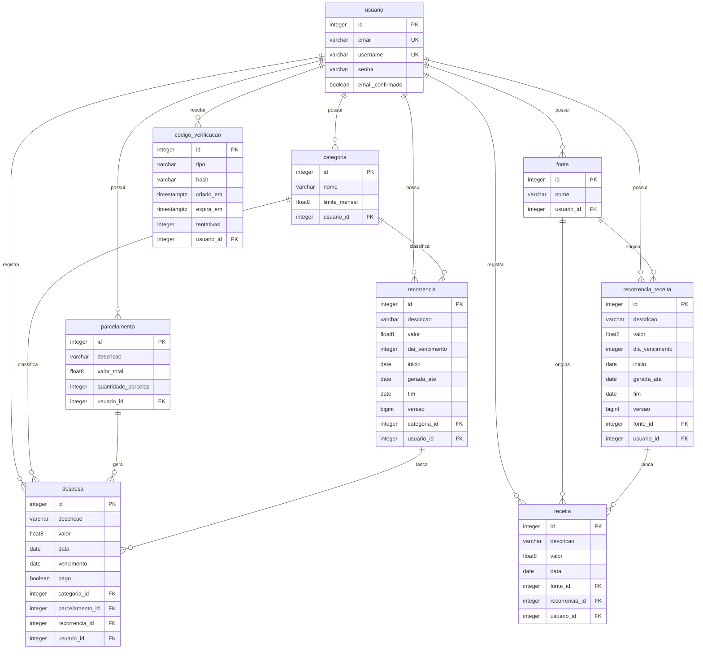

# Dicionário de dados

Este documento descreve as tabelas do banco do Finora, os campos de cada uma e o que cada campo faz. Os nomes físicos e a nulidade foram conferidos no schema gerado pelo Hibernate (`spring.jpa.hibernate.ddl-auto=update`) no H2 local e estão descritos nos tipos equivalentes do PostgreSQL usado em produção. O Hibernate converte os nomes das classes e dos atributos para `snake_case`. No H2 esses nomes aparecem em maiúsculas; no PostgreSQL ficam em minúsculas, que é a forma usada aqui.

A classe `RecorrenciaBase` não é uma tabela: é um `@MappedSuperclass` cujos campos aparecem tanto em `recorrencia` quanto em `recorrencia_receita`. A classe `Alerta` também não é uma tabela: os avisos de 80% e 100% do limite são calculados na hora, a partir das categorias e das despesas do mês.

Várias colunas `usuario_id` (e alguns campos acrescentados depois, como `username` e `vencimento`) aceitam nulo no banco porque o sistema passou a ter login e novas funcionalidades depois dos primeiros registros. Nas contas e nos lançamentos novos a aplicação sempre preenche o dono. Na primeira execução, registros antigos sem dono são atribuídos à conta de demonstração.

## Relacionamentos

## usuario

Pessoa que usa o sistema. Cada usuário enxerga apenas os próprios registros. O login aceita o e-mail ou o nome de usuário.

| Campo | Tipo | Obrigatório | Chave | Descrição |
|---|---|---|---|---|
| id | integer (identity) | Sim | PK | Identificador da conta. |
| nome | varchar(255) | Não | | Nome de exibição da pessoa. O cadastro pede o nome, mas a coluna aceita nulo porque a entidade não marca o campo como obrigatório no banco. |
| email | varchar(255) | Sim | única | E-mail da conta, gravado em minúsculas e sem espaços nas pontas. Serve para entrar no sistema e para receber o código de verificação. |
| senha | varchar(255) | Sim | | Hash BCrypt da senha. O texto puro nunca é gravado. |
| username | varchar(30) | Não | única | Nome de usuário, só com letras minúsculas, números, ponto, hífen e sublinhado, de 3 a 30 caracteres. É gravado em minúsculas, então o índice único já não diferencia maiúsculas. A coluna foi adicionada depois: contas antigas recebem um valor na inicialização, gerado a partir da parte antes do `@` no e-mail. Também serve para o login. |
| email_confirmado | boolean | Não | | `false` significa que a conta ainda aguarda o código enviado por e-mail. `true` ou nulo (conta antiga, de antes da confirmação existir) é tratado como confirmado, para ninguém ficar trancado do lado de fora. Quem redefine a senha com um código recebido no e-mail também tem a conta marcada como confirmada. |

## categoria

Categoria de despesa (por exemplo Alimentação ou Transporte), com um limite de gasto mensal opcional.

O nome não pode se repetir entre as categorias do mesmo usuário, ignorando maiúsculas. Essa regra vale só na aplicação: não há restrição única no banco. Não é possível excluir uma categoria que ainda tenha despesas ou despesas fixas ligadas a ela. Contas novas já começam com as categorias Alimentação (limite 400), Transporte (150) e Lazer (100), que a pessoa pode editar ou excluir depois.

O campo `temLimite` do formulário e da API não é uma coluna: no banco, ter limite significa `limite_mensal > 0`.

| Campo | Tipo | Obrigatório | Chave | Descrição |
|---|---|---|---|---|
| id | integer (identity) | Sim | PK | Identificador da categoria. |
| nome | varchar(40) | Sim | | Nome da categoria, com no máximo 40 caracteres. Não pode ficar em branco. |
| limite_mensal | double precision | Sim | | Limite de gasto no mês. O valor 0 significa "sem limite", para a coluna existente continuar igual e nenhuma migração ser necessária. Sem limite, o nível da categoria é sempre "OK" e não há alerta. Com limite, o nível passa a "ATENCAO" a partir de 80% e a "ESTOURADO" a partir de 100%. Quando o limite está ativado no formulário, a aplicação exige um valor maior que zero. |
| usuario_id | integer | Não | FK para usuario.id | Dono da categoria. Aceita nulo por causa dos registros anteriores ao login. Nas categorias novas a aplicação sempre preenche o dono. |

## fonte

Origem de uma receita (por exemplo Mesada, Bolsa ou Estágio), cadastrada pela própria pessoa.

O nome não pode se repetir entre as fontes do mesmo usuário, ignorando maiúsculas. Essa regra vale só na aplicação. Não é possível excluir uma fonte que ainda tenha receitas ou receitas fixas ligadas a ela. Contas novas já começam com Mesada, Bolsa e Estágio.

| Campo | Tipo | Obrigatório | Chave | Descrição |
|---|---|---|---|---|
| id | integer (identity) | Sim | PK | Identificador da fonte. |
| nome | varchar(40) | Sim | | Nome da fonte, com no máximo 40 caracteres. Não pode ficar em branco. |
| usuario_id | integer | Não | FK para usuario.id | Dono da fonte. Aceita nulo por causa dos registros anteriores ao login. Nas fontes novas a aplicação sempre preenche o dono. |

## despesa

Lançamento de gasto com vencimento próprio: uma despesa à vista, uma parcela de uma compra parcelada (`parcelamento`) ou o lançamento de um mês de uma despesa fixa (`recorrencia`). Uma despesa não é fixa e parcelada ao mesmo tempo: ao ligar o lançamento a uma recorrência, a aplicação remove qualquer informação de parcela.

Os campos `vencimento`, `pago`, `numero_parcela`, `total_parcelas`, `parcelamento_id` e `recorrencia_id` foram adicionados depois e aceitam nulo, para os registros antigos continuarem valendo. Valores monetários são arredondados para duas casas decimais no cadastro e na edição. Lançamentos novos começam como pendentes.

| Campo | Tipo | Obrigatório | Chave | Descrição |
|---|---|---|---|---|
| id | integer (identity) | Sim | PK | Identificador do lançamento. |
| descricao | varchar(255) | Sim | | Descrição da despesa. Não pode ficar em branco. |
| valor | double precision | Sim | | Valor deste lançamento. Numa compra parcelada, é o valor da parcela. Precisa ser maior que zero. |
| data | date | Sim | | Data da compra ou do lançamento. |
| vencimento | date | Não | | Data de vencimento. É ela que define em qual mês o lançamento aparece no painel e nas listagens. Nos registros antigos, sem vencimento, vale a própria `data`. |
| pago | boolean | Não | | `true` = pago, `false` = pendente. Nulo é registro antigo e conta como pago, porque era assim que o saldo já o considerava. |
| numero_parcela | integer | Não | | Número desta parcela (1, 2, 3...). Nulo nas despesas à vista e nas fixas. |
| total_parcelas | integer | Não | | Quantidade total de parcelas da compra. Nulo nas despesas à vista e nas fixas. Quando é maior que 1, o lançamento é tratado como parcelado. |
| parcelamento_id | integer | Não | FK para parcelamento.id | Compra parcelada à qual esta parcela pertence. Nulo nas despesas à vista e nas fixas. |
| recorrencia_id | integer | Não | FK para recorrencia.id | Despesa fixa da qual este lançamento faz parte. Nulo nas demais. |
| categoria_id | integer | Sim | FK para categoria.id | Categoria do gasto. |
| usuario_id | integer | Não | FK para usuario.id | Dono do lançamento. Aceita nulo por causa dos registros anteriores ao login. Nos lançamentos novos a aplicação sempre preenche o dono. |

## receita

Receita registrada pela pessoa. Pode ser avulsa ou o lançamento de um mês de uma receita fixa (`recorrencia_receita`). Diferente da despesa, o mês do lançamento é o mês da `data` (não há vencimento nem status de pagamento). Valores monetários são arredondados para duas casas decimais no cadastro e na edição.

| Campo | Tipo | Obrigatório | Chave | Descrição |
|---|---|---|---|---|
| id | integer (identity) | Sim | PK | Identificador do lançamento. |
| descricao | varchar(255) | Sim | | Descrição da receita. Não pode ficar em branco. |
| valor | double precision | Sim | | Valor do lançamento. Precisa ser maior que zero. |
| data | date | Sim | | Data da receita. Define em qual mês ela aparece. |
| fonte_id | integer | Sim | FK para fonte.id | Origem da receita. |
| usuario_id | integer | Não | FK para usuario.id | Dono do lançamento. Aceita nulo por causa dos registros anteriores ao login. Nos lançamentos novos a aplicação sempre preenche o dono. |
| recorrencia_id | integer | Não | FK para recorrencia_receita.id | Receita fixa da qual este lançamento faz parte. Nulo nas receitas avulsas. Coluna adicionada depois. |

## parcelamento

Compra parcelada (a "despesa original"). Cada parcela é gravada como uma `despesa` própria, com valor, vencimento e status de pagamento, ligada a este registro.

Com 1 parcela a aplicação grava um único lançamento à vista e não cria um `parcelamento`. Com 2 ou mais, cria esta compra e uma despesa por parcela, até no máximo 120. Os centavos que sobram da divisão vão, um a um, para as primeiras parcelas, então a soma é sempre igual ao valor total (por exemplo, R$ 100,00 em 3 parcelas vira 33,34 + 33,33 + 33,33). Cada vencimento parte do dia da primeira parcela; se o mês não tem esse dia, usa o último dia do mês, sem alterar os meses seguintes (por exemplo, 31/01, 28/02 e 31/03). Se o valor de uma parcela pendente é editado e a alteração vale para as demais pendentes, o `valor_total` é recalculado como a soma exata das parcelas. Parcelas pagas não são alteradas nessa edição. Quando a última parcela é excluída, a compra também é removida.

`descricao`, `data` e `primeiro_vencimento` aceitam nulo no banco porque a entidade não marca esses campos como obrigatórios, mas a aplicação os preenche ao criar a compra.

| Campo | Tipo | Obrigatório | Chave | Descrição |
|---|---|---|---|---|
| id | integer (identity) | Sim | PK | Identificador da compra parcelada. |
| descricao | varchar(255) | Não | | Descrição da compra, copiada para cada parcela no momento do cadastro. |
| valor_total | double precision | Sim | | Valor total da compra, sempre a soma exata de todas as parcelas. |
| quantidade_parcelas | integer | Sim | | Quantidade de parcelas da compra (de 2 a 120). |
| primeiro_vencimento | date | Não | | Vencimento da primeira parcela. Os vencimentos seguintes partem deste dia. |
| data | date | Não | | Data da compra. |
| usuario_id | integer | Não | FK para usuario.id | Dono da compra. Aceita nulo no schema; na prática a aplicação preenche o dono ao criar o parcelamento. |

## recorrencia

Despesa fixa, recorrente todo mês (por exemplo aluguel ou internet). Cada mês vira uma `despesa` própria, com valor, vencimento e status de pagamento, ligada a este registro. Os campos comuns com a receita fixa vêm de `RecorrenciaBase`.

Os lançamentos dos meses seguintes não dependem de agendamento (o plano gratuito do Render dorme): as páginas pedem a geração e só os meses que faltam são criados, até o mês consultado, no máximo 12 meses depois do mês atual. O campo `gerada_ate` guarda o último mês já lançado, então a geração nunca duplica um mês nem recria um lançamento excluído. A coluna `versao` evita que duas requisições ao mesmo tempo lancem o mesmo mês.

Encerrar a despesa fixa a partir de um lançamento define `fim` como o mês anterior a ele, exclui esse lançamento e os meses seguintes ainda pendentes, e não lança mês novo. Os meses anteriores e qualquer mês já pago continuam no histórico. Se não sobrar nenhum lançamento, a própria recorrência é apagada. Ao editar o valor com a opção de aplicar nos demais, o novo valor passa a valer para os próximos meses (já lançados e ainda pendentes, e os que serão lançados). Meses anteriores não mudam.

`inicio`, `gerada_ate` e `fim` são gravados como o dia 1º do mês.

| Campo | Tipo | Obrigatório | Chave | Descrição |
|---|---|---|---|---|
| id | integer (identity) | Sim | PK | Identificador da despesa fixa. |
| descricao | varchar(255) | Não | | Descrição copiada para cada lançamento mensal. Aceita nulo no banco; a aplicação preenche a partir da primeira despesa. |
| valor | double precision | Sim | | Valor usado nos próximos lançamentos. |
| dia_vencimento | integer | Sim | | Dia do mês do vencimento (1 a 31). Em meses mais curtos vale o último dia (por exemplo, 31 vira 28 ou 29 em fevereiro), sem alterar os meses seguintes. |
| inicio | date | Não | | Mês do primeiro lançamento, gravado como o dia 1º. |
| gerada_ate | date | Não | | Último mês já lançado, gravado como o dia 1º. A geração só cria os meses depois dele. |
| fim | date | Não | | Último mês da recorrência, gravado como o dia 1º. Nulo enquanto ela estiver ativa, sem data para acabar. |
| versao | bigint | Sim | | Controle de concorrência otimista (`@Version`). Se duas requisições tentam lançar os mesmos meses ao mesmo tempo, uma delas é desfeita e nada duplica. |
| categoria_id | integer | Não | FK para categoria.id | Categoria dos lançamentos. Aceita nulo no banco; a aplicação preenche a partir da primeira despesa. |
| usuario_id | integer | Não | FK para usuario.id | Dono da despesa fixa. Aceita nulo no schema; a aplicação preenche o dono ao criar a recorrência. |

## recorrencia_receita

Receita fixa, recorrente todo mês (por exemplo estágio ou mesada). Cada mês vira uma `receita` própria, ligada a este registro. As regras de meses, geração sob demanda (até 12 meses à frente), `gerada_ate` e `versao` são as mesmas de `recorrencia`.

Na exclusão, a aplicação permite apagar só este mês (a receita fixa continua nos próximos), este mês e os seguintes (encerra a recorrência e mantém os meses anteriores) ou todos os meses, inclusive os anteriores, junto com a própria receita fixa. Ao editar o valor com a opção de aplicar nos seguintes, o novo valor passa a valer também para os meses seguintes já lançados e para os futuros. Meses anteriores não mudam.

| Campo | Tipo | Obrigatório | Chave | Descrição |
|---|---|---|---|---|
| id | integer (identity) | Sim | PK | Identificador da receita fixa. |
| descricao | varchar(255) | Não | | Descrição copiada para cada lançamento mensal. Aceita nulo no banco; a aplicação preenche a partir da primeira receita. |
| valor | double precision | Sim | | Valor usado nos próximos lançamentos. |
| dia_vencimento | integer | Sim | | Dia do mês do lançamento (1 a 31). Em meses mais curtos vale o último dia. |
| inicio | date | Não | | Mês do primeiro lançamento, gravado como o dia 1º. |
| gerada_ate | date | Não | | Último mês já lançado, gravado como o dia 1º. A geração só cria os meses depois dele. |
| fim | date | Não | | Último mês da recorrência, gravado como o dia 1º. Nulo enquanto ela estiver ativa. |
| versao | bigint | Sim | | Controle de concorrência otimista (`@Version`), com o mesmo papel que em `recorrencia`. |
| usuario_id | integer | Não | FK para usuario.id | Dono da receita fixa. Aceita nulo no schema; a aplicação preenche o dono ao criar a recorrência. |
| fonte_id | integer | Não | FK para fonte.id | Fonte dos lançamentos. Aceita nulo no banco; a aplicação preenche a partir da primeira receita. |

## codigo_verificacao

Código de 6 dígitos enviado por e-mail para confirmar a conta nova ou para redefinir a senha. Só o hash é gravado; o código em texto puro nunca fica no banco nem em memória depois do envio.

O código vale 15 minutos, serve uma vez só e aceita 5 tentativas. O registro é apagado ao ser usado, ao esgotar as tentativas ou quando expira. Ao pedir um código novo, os códigos já vencidos de todo mundo são apagados, e o código anterior do mesmo tipo para aquela pessoa também é removido. Por isso, na prática existe no máximo um código ativo por usuário e tipo, embora isso não seja uma restrição única no banco. Se o código anterior foi pedido há menos de 60 segundos, um novo não é gerado.

Em produção, se nenhum provedor de e-mail estiver configurado, a confirmação e a recuperação ficam desligadas: contas novas entram direto e a recuperação some da tela, para nenhum código ir parar no log do servidor.

| Campo | Tipo | Obrigatório | Chave | Descrição |
|---|---|---|---|---|
| id | integer (identity) | Sim | PK | Identificador do código. |
| usuario_id | integer | Sim | FK para usuario.id | Conta à qual o código pertence. |
| tipo | varchar(20) | Sim | | Motivo do código. Valores possíveis: `CONFIRMAR_EMAIL` (confirmar a conta nova) e `REDEFINIR_SENHA` (esqueci minha senha). |
| hash | varchar(64) | Sim | | SHA-256 do código de 6 dígitos, gravado em hexadecimal (64 caracteres). A conferência compara o hash do valor digitado com este campo, sem revelar o código. |
| criado_em | timestamptz | Não | | Instante em que o código foi gerado. A aplicação usa este campo para recusar um reenvio em menos de 60 segundos. Aceita nulo no banco, mas é preenchido na criação. |
| expira_em | timestamptz | Não | | Instante em que o código deixa de valer (15 minutos depois de `criado_em`). Aceita nulo no banco, mas é preenchido na criação. |
| tentativas | integer | Sim | | Quantidade de tentativas erradas já feitas. Começa em 0 e sobe a cada código incorreto. Na quinta tentativa o registro é apagado. |
