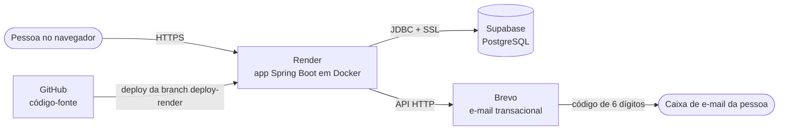

# Serviços e tecnologias externas

Este documento lista os serviços externos e as principais bibliotecas que o Finora usa, explicando para que serve cada um. Nenhuma senha, chave ou endereço de conexão aparece aqui: em produção esses valores ficam só nas variáveis de ambiente do Render.

## Visão geral

No computador de cada integrante, a aplicação roda com o banco H2 em arquivo e os e-mails vão para o log, sem depender de nenhum serviço externo.

## Serviços em nuvem

| Serviço | Para que usamos | Como está configurado |
|---|---|---|
| **GitHub** | Guarda o código-fonte, o histórico de versões, a documentação e os pull requests de revisão. | Repositório `anabeatrizguidelli/finora-control`. A branch `main` recebe o trabalho revisado; a branch `deploy-render` é a que vai para produção. |
| **Render** | Hospeda a aplicação na internet (o endereço que a turma acessa). | Web Service no plano Free, construído a partir do `Dockerfile` da branch `deploy-render`, com deploy manual. No plano Free o serviço "dorme" quando fica sem acesso e pode levar cerca de um minuto para acordar no primeiro acesso. |
| **Supabase** | Banco de dados PostgreSQL de produção, onde ficam as contas, os lançamentos e os códigos de verificação. | Projeto na região de São Paulo (`sa-east-1`), acessado pelo pooler de conexões do Supabase com SSL obrigatório. As tabelas são criadas e atualizadas pelo próprio Hibernate (`ddl-auto=update`). A estrutura está no [dicionário de dados](dicionario-de-dados.md). |
| **Brevo** | Envia os e-mails transacionais: o código de confirmação da conta nova e o código de "esqueci minha senha". | Usamos a API HTTP transacional (`https://api.brevo.com/v3/smtp/email`) em vez de SMTP, porque o plano Free do Render bloqueia as portas SMTP. O envio é feito pela classe `EnvioEmail.Brevo`, só com o cliente HTTP do Java. |
| **Google Fonts** | Fontes do visual (Plus Jakarta Sans para textos e JetBrains Mono para valores). | Carregadas pelo navegador a partir de `fonts.googleapis.com` no fragmento `fragmentos.html`. |

### Variáveis de ambiente de produção

Só os nomes. Os valores ficam cadastrados no painel do Render e nunca vão para o repositório.

| Variável | O que define |
|---|---|
| `SPRING_PROFILES_ACTIVE` | Ativa o perfil `prod` (já vem definido no `Dockerfile`). |
| `PORT` | Porta em que o Render espera a aplicação (padrão 8080). |
| `SPRING_DATASOURCE_URL` | Endereço JDBC do banco PostgreSQL do Supabase. |
| `SPRING_DATASOURCE_USERNAME` | Usuário do banco. |
| `SPRING_DATASOURCE_PASSWORD` | Senha do banco. |
| `MAIL_API_KEY` | Chave da API da Brevo. Sem ela, o envio real de e-mail fica desligado. |
| `MAIL_FROM` | E-mail remetente validado na Brevo. |
| `MAIL_FROM_NAME` | Nome que aparece como remetente (padrão "Finora"). |

Em produção, se `MAIL_API_KEY` ou `MAIL_FROM` não estiverem definidas, a confirmação de e-mail e a recuperação de senha ficam desligadas, para que nenhum código vá parar no log do servidor.

## Tecnologias usadas no projeto

| Tecnologia | Para que serve no Finora |
|---|---|
| **Java 21** | Linguagem da aplicação. |
| **Spring Boot 4.1** | Base da aplicação: servidor web embutido, configuração e injeção de dependências. |
| **Spring Web MVC** | Controllers das telas e da API JSON (`/api/...`). |
| **Thymeleaf** | Monta as páginas HTML no servidor (`src/main/resources/templates`). |
| **Spring Data JPA + Hibernate** | Mapeia as classes do pacote `model` para tabelas e faz as consultas pelos repositórios. |
| **Bean Validation** | Valida os formulários (descrição obrigatória, valor maior que zero, limite não negativo etc.). |
| **Spring Security + BCrypt** | Login por formulário nas telas e HTTP Basic na API, proteção CSRF nos formulários e senhas guardadas como hash BCrypt. |
| **SHA-256 (Java)** | Os códigos de verificação enviados por e-mail ficam no banco apenas como hash SHA-256. |
| **H2 Database** | Banco em arquivo (`./data`) para rodar localmente sem instalar nada, com console em `/h2-console`. Os testes usam um H2 em memória separado. |
| **PostgreSQL (driver JDBC)** | Conexão com o banco do Supabase em produção. |
| **Maven (Maven Wrapper)** | Compila, roda os testes e gera o `.jar`. O `mvnw` baixa o Maven sozinho. |
| **Docker** | O `Dockerfile` compila o projeto com Maven e roda o `.jar` numa imagem Java 21 enxuta. É o que o Render usa. |
| **JUnit 5 + Spring Boot Test** | Testes automatizados (105 testes no registro de 13/11/2026). |
| **HTML, CSS e JavaScript** | Visual responsivo, modo claro e escuro, confirmações e cadastro rápido de categoria ou fonte. |

## Ferramentas de apoio

| Ferramenta | Para que usamos |
|---|---|
| **draw.io (diagrams.net)** | Diagramas UML em `docs/*.drawio`. |
| **DBeaver** | Consultar o banco de produção do Supabase durante o desenvolvimento e os testes. |
| **Git** | Versionamento e envio das alterações para o GitHub. |
